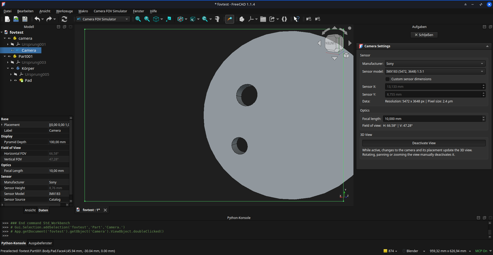
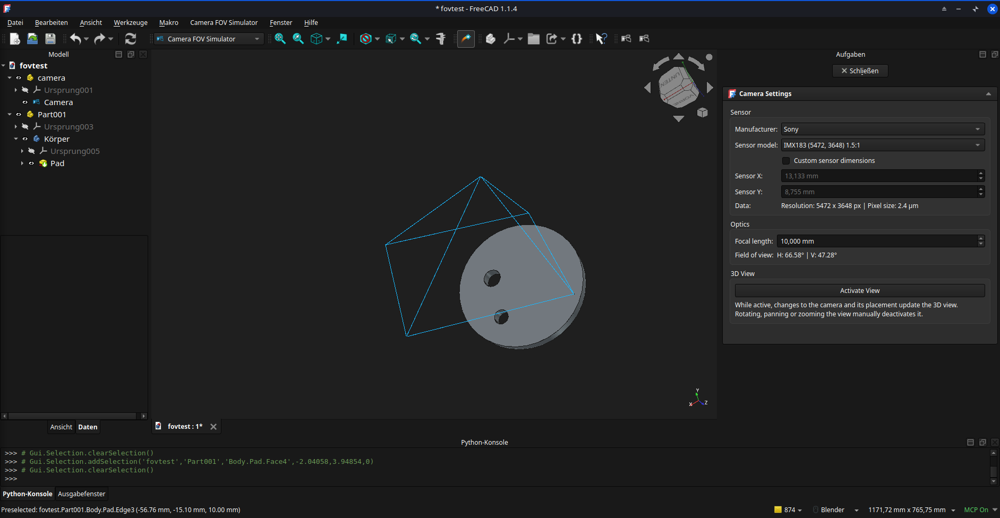

# Camera FOV Simulator for FreeCAD
A tiny vibe-coded plugin (workbench) that let's you create a camera, pick a sensor (or define your own) and a focal length. Get pyramid of your field of view in 3D, and a button to switch the 3D-View to match your cameras view. Updates apply on the fly. Not much to it, but if you deal with vision systems it may save you a lot of back and forth between FreeCAD and Blender.

Contains a list of popular sensors which you can find over at [Commonlands ](https://commonlands.com/pages/image-sensors). They sell lenses and accessories and they have really neat caculators online.

It's all that I needed. There is potential for more features like a depth of field calculator buildin etc. But if you get to that point you might as well use Blender which does all of this much better.

It was literally 3 promts and 20 cents (half of it burned on a bugfix that prevented the deletion of the camera).